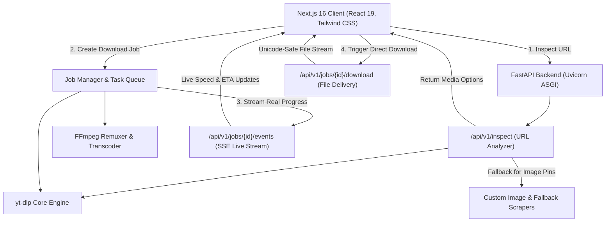

# 🎬 VYDRIVO – High-Performance Multi-Platform Media Downloader

<p align="center">
  
</p>

<p align="center">
  <b>A sleek, modern, all-in-one media downloader designed for YouTube, Instagram, Facebook, and Pinterest.</b><br/>
  Download high-definition videos (MP4), extract crystal-clear audio (MP3 up to 320 kbps), and grab untouched full-resolution graphics and photos (JPG) with real-time SSE progress streaming.
</p>

<p align="center">
  
  
  
  
  
  
</p>

---

## 🌟 Supported Platforms & Capabilities

| Platform | Supported Formats | Video Quality | Audio Quality | Image / Photo Extraction |
| :--- | :--- | :--- | :--- | :--- |
| **YouTube** | Standard Videos, Shorts, Clips | 1080p, 720p, 480p, 360p (MP4) | 320 kbps, 192 kbps, 128 kbps (MP3) | High-Res Thumbnail |
| **Instagram** | Reels, Video Posts, Carousels | 1080p, 720p (MP4) | Original Audio (MP3) | Full-Res Cover & Post Photos (JPG) |
| **Facebook** | Facebook Watch, Public Videos, Reels | HD & SD Streams (MP4) | High-Bitrate MP3 | Full-Res Cover Images (JPG) |
| **Pinterest** | Pins, Idea Videos, Wallpapers, Posters | Original MP4 Video | Extracted MP3 Audio | Original Full-Resolution Graphics (JPG) |

---

## ⚡ Key Highlights

- **Multi-Platform Tab Navigation**:
  - Seamlessly switch between **YouTube**, **Instagram**, **Facebook**, and **Pinterest**.
  - **Sticky Elastic Switch Animation**: Active pill highlights dynamically stretch like a rubber band (`scaleX` spring physics) across tabs before snapping into place with an elastic bounce.
- **Dynamic Animated Preloader**:
  - Multi-platform logo gathering (YouTube red, Instagram gradient, Facebook blue, Pinterest scarlet) with fluid color mixing and animated **VYDRIVO** typography.
- **Smart Scraper Fallbacks**:
  - Handles photo-only pins on Pinterest without crashing by resolving preload links directly to untouched `/originals/` resolution.
  - Automatic fallback handles Instagram posts, reels, and cover photos cleanly.
- **Lossless FFmpeg Audio-Video Remuxing**:
  - Combines separate high-bitrate video streams and audio tracks into standard, globally compatible MP4 files without quality loss.
- **Real-Time Live Progress (SSE)**:
  - Powered by **Server-Sent Events** (`sse-starlette`) providing live download speed (MB/s), estimated time remaining (ETA), and genuine download percentage.
- **Zero Fabrication**:
  - 100% honest backend progress feedback with no fake timers or artificial delays.
- **Automatic Self-Cleaning Disk Storage**:
  - A background garbage-collection worker periodically purges downloaded and converted files older than 30 minutes to conserve disk space.
- **RFC 5987 Unicode Filename Support**:
  - Correctly encodes download headers to support international characters, Hindi/Devanagari scripts, special symbols, and emojis in media titles.

---

## 🏗️ System Architecture



---

## 🛠️ Tech Stack & Libraries

### Frontend
- **Framework**: [Next.js 16.4](https://nextjs.org/) (App Router, React 19)
- **Styling**: [Tailwind CSS v4](https://tailwindcss.com/)
- **Typography**: [Outfit](https://fonts.google.com/specimen/Outfit) via Google Fonts
- **Icons**: [Lucide React](https://lucide.dev/)
- **Transitions**: Native CSS cubic-bezier springs & sticky slide-scale keyframes
- **Language**: TypeScript

### Backend
- **Framework**: [FastAPI](https://fastapi.tiangolo.com/) (Python 3.12+)
- **Extraction Engine**: [yt-dlp](https://github.com/yt-dlp/yt-dlp)
- **Multimedia Processing**: [FFmpeg](https://ffmpeg.org/) (via `imageio-ffmpeg` and system binaries)
- **Real-Time Streaming**: [sse-starlette](https://github.com/sysid/sse-starlette)
- **Server**: [Uvicorn](https://www.uvicorn.org/)

---

## 🚀 Installation & Local Development

### Prerequisites
1. **Node.js** (v18.0 or newer)
2. **Python** (v3.10 or newer)
3. **FFmpeg** installed on your system (e.g. `winget install Gyan.FFmpeg` on Windows, `brew install ffmpeg` on macOS, or `sudo apt install ffmpeg` on Ubuntu/Debian).

---

### Step 1: Clone the Repository

```bash
git clone https://github.com/FaizanGouri/vydrivo.git
cd vydrivo
```

---

### Step 2: Start the Backend API

```bash
# Navigate to backend directory
cd backend

# Create a virtual environment
python -m venv venv

# Activate the virtual environment
# Windows (PowerShell):
.\venv\Scripts\Activate.ps1
# Windows (CMD):
.\venv\Scripts\activate.bat
# Linux / macOS:
source venv/bin/activate

# Install required Python packages
pip install -r requirements.txt

# Start the FastAPI server
python -m uvicorn main:app --host 127.0.0.1 --port 8000 --reload
```

The backend server will run at:
👉 **`http://127.0.0.1:8000`** (Interactive OpenAPI Docs available at `http://127.0.0.1:8000/docs`)

---

### Step 3: Start the Next.js Frontend

Open a second terminal window:

```bash
# Navigate to frontend directory
cd frontend

# Install dependencies
npm install

# Start the Next.js development server
npm run dev
```

Open your browser and navigate to:
👉 **[http://localhost:3000](http://localhost:3000)**

---

## 📡 REST API Reference

### 1. Inspect Media URL
**`POST /api/v1/inspect`**

Analyzes the provided URL and extracts metadata, thumbnails, duration, and available download options.

```json
// Request Body
{
  "url": "https://www.youtube.com/watch?v=..."
}

// Success Response (200 OK)
{
  "success": true,
  "data": {
    "id": "dQw4w9WgXcQ",
    "url": "https://www.youtube.com/watch?v=...",
    "title": "Sample Media Title",
    "thumbnail": "https://...",
    "duration_formatted": "03:32",
    "uploader": "Channel or Creator Name",
    "view_count": 1450000,
    "platform": "youtube",
    "is_short": false,
    "options": [
      {
        "quality": "1080p",
        "format": "mp4",
        "label": "1080p (Full HD Video)",
        "type": "video"
      },
      {
        "quality": "720p",
        "format": "mp4",
        "label": "720p (HD Video)",
        "type": "video"
      },
      {
        "quality": "320kbps",
        "format": "mp3",
        "label": "Audio Only (320kbps MP3)",
        "type": "audio"
      }
    ]
  }
}
```

---

### 2. Create Download Job
**`POST /api/v1/jobs`**

Queues a new background processing job.

```json
// Request Body
{
  "url": "https://www.instagram.com/reel/...",
  "format": "video",       // "video" | "audio" | "image"
  "quality": "1080p"       // "1080p", "720p", "320kbps", "Original"
}

// Response
{
  "success": true,
  "job_id": "8bfa2e12-3a1b-4d98-8ce2-47ef8d91a01c",
  "status": "processing"
}
```

---

### 3. Stream Job Progress (SSE)
**`GET /api/v1/jobs/{job_id}/events`**

Streams real-time Server-Sent Events with progress updates:

```text
data: {"job_id":"...","status":"processing","progress":42.5,"speed":"12.4MiB/s","eta":"00:04"}

data: {"job_id":"...","status":"processing","progress":88.0,"speed":"Merging video and audio...","eta":""}

data: {"job_id":"...","status":"completed","progress":100.0,"speed":"","eta":"","filename":"video.mp4","file_size":24560124}
```

---

### 4. Download Converted Media
**`GET /api/v1/jobs/{job_id}/download`**

Serves the finalized file with `Content-Disposition: attachment; filename*=UTF-8''...` headers.

---

## 🔒 Security & Best Practices

- **Centralized SSRF & DNS Validation**: Validates exact platform hostnames against a strict allowlist. Resolves hostnames and rejects loopback (`127.0.0.1`), private subnets (`10.0.0.0/8`, `172.16.0.0/12`, `192.168.0.0/16`), and cloud metadata targets (`169.254.169.254`, `0.0.0.0/8`, `::1`).
- **Redirect Revalidation**: Secondary media and pin scraping manually re-validates each redirect destination against SSRF rules.
- **In-Memory Rate Limiting**: Per-IP sliding-window limits protect `/api/v1/inspect` (30 req/min) and `/api/v1/jobs` (10 req/min) with HTTP 429 Retry-After responses.
- **Bounded Worker Pool & Queue**: Concurrency is limited to a bounded thread pool (default 4 workers, queue capacity 25) with automatic rejection (HTTP 503) during saturation.
- **Path Traversal Protection**: File delivery strictly validates that requested file paths reside within the real `downloads/` directory.
- **Temporary File Lifecycle**: Downloaded files are purged automatically after 30 minutes, with startup disk scanning removing orphaned files left from past server interruptions.
- **Sanitized Filenames**: Media titles are stripped of dangerous filesystem characters and safe-encoded according to RFC 5987.
- **Safe CORS Configuration**: Explicit configurable origins via `ALLOWED_ORIGINS`; wildcards are never paired with credentials.
- **No Secret Storage**: Does not log or store cookies, personal authentication tokens, or user data.

---

## 🧪 Automated Testing

The backend includes a comprehensive automated test suite (21 unit tests) covering security, SSRF defense, job state transitions, API contract validation, and extraction mocks.

To run the automated tests:

```bash
# Navigate to backend directory
cd backend

# Run the full test suite
python -m unittest discover -s tests -v
```

---

## ⚙️ Environment Variables Reference

### Backend (`backend/.env`)
| Variable | Default | Description |
| :--- | :--- | :--- |
| `HOST` | `127.0.0.1` | ASGI server bind address |
| `PORT` | `8000` | ASGI server port |
| `ALLOWED_ORIGINS` | `http://localhost:3000,http://127.0.0.1:3000` | Comma-separated list of allowed CORS origins |
| `MAX_CONCURRENT_JOBS` | `4` | Maximum parallel download/conversion threads |
| `MAX_QUEUE_CAPACITY` | `25` | Maximum queued jobs before HTTP 503 saturation |
| `JOB_TIMEOUT_SECONDS` | `300` | Execution timeout per download task |
| `FFMPEG_PATH` | *(Auto-detected)* | Path to custom FFmpeg executable |

### Frontend (`frontend/.env.local`)
| Variable | Default | Description |
| :--- | :--- | :--- |
| `NEXT_PUBLIC_API_URL` | `http://127.0.0.1:8000/api/v1` | Public backend API endpoint base URL |

---

## 📄 License

This project is licensed under the [MIT License](LICENSE) and is intended for personal and educational media backup purposes.
